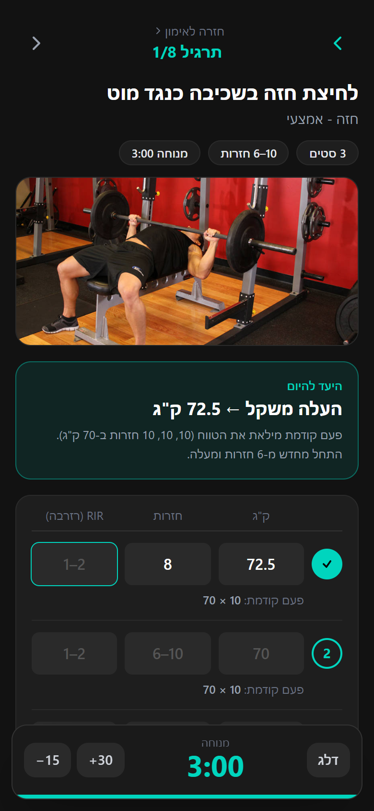
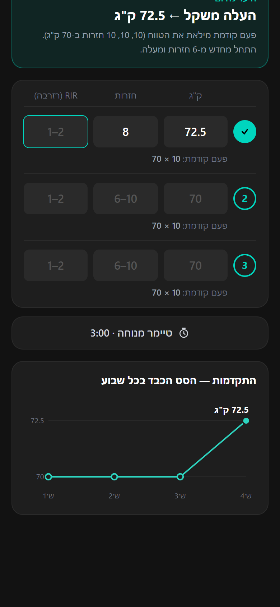
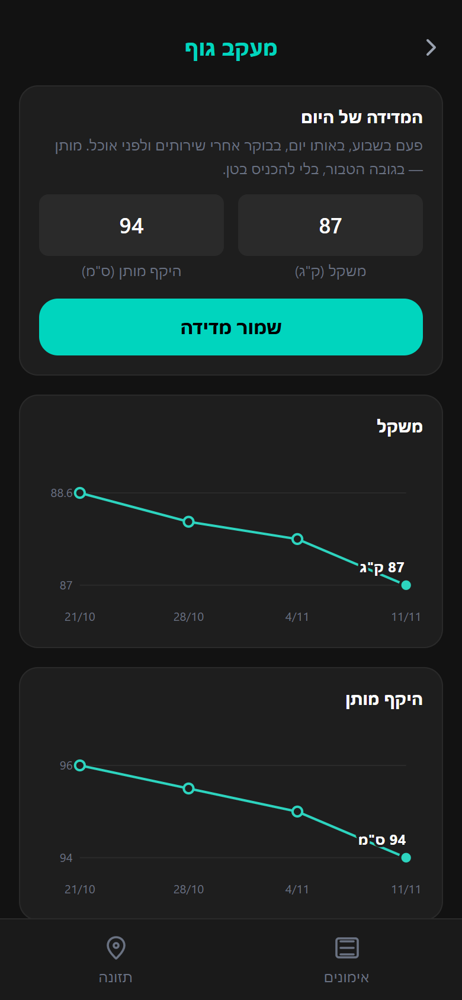

# Fitness Tracker (PWA)

A personal workout and nutrition tracker for two people, built as an installable, offline-first web app. It runs on our iPhones from the home screen and replaces a third-party fitness app with one fitted to our own training programs. The interface is in Hebrew (right-to-left).

<p>
  
  
  
</p>

## What it does

- **Two users, two programs.** Each user has their own training program and their own exercise screen; the weeks → sessions → exercises → sets structure is shared.
- **Set logging.** Weight, reps and RIR (reps in reserve) per set, with completion rolling up from set to exercise, session and week.
- **Progression coaching.** For rep-range programs the app applies double progression: once every set reaches the top of the range it tells you to add weight, otherwise to add a rep. It shows last week's numbers under each set and marks personal records (estimated 1RM, Epley formula).
- **Rest timer.** Starts automatically when a set is completed. It stores the end time rather than counting down, so it stays correct while the phone is locked.
- **Progress charts.** Heaviest set per week for every exercise, plus body weight and waist over time (hand-written SVG, no chart library).
- **Nutrition.** A per-user meal plan with daily check-offs, calorie-matched alternatives for each food, and a daily calories/macros summary.
- **Installable and offline.** A service worker caches the app and exercise photos, so it works with poor reception at the gym.

## Tech stack

| Area | Choice |
|---|---|
| UI | React 19, TypeScript, React Router |
| Styling | Tailwind CSS v4 |
| Storage | IndexedDB through Dexie.js, reactive queries with `dexie-react-hooks` |
| PWA | `vite-plugin-pwa` (Workbox) |
| Build | Vite |
| Hosting | Netlify (static) |

There is no backend. All data lives in the browser's IndexedDB on each phone.

## How the code is organised

```
src/
  db/index.ts            Database schema, versioned migrations, program templates, seeding
  pages/                 One file per screen (weeks, week, session, exercise, nutrition, body)
  pages/ExerciseRoute    Chooses the exercise screen by the program the exercise belongs to
  pages/ProExercisePage  Rep ranges, today's target, records, progress chart
  timer/                 Global rest-timer store (useSyncExternalStore) and its floating bar
  hooks/                 Current user (shared store over localStorage), current program
  nutrition/             Static meal plans, daily log hook, shared UI pieces
  components/            Bottom navigation, line chart, body-tracking card
```

A few decisions worth pointing out:

- **Non-destructive schema migrations.** Adding the second program (schema v8) tags existing sessions and inserts the new ones inside the upgrade transaction, so logged workouts survive app updates.
- **Save on blur, not on every keystroke.** Writing to IndexedDB on each keystroke re-rendered the live query and reset the input mid-typing; inputs keep local state and persist on blur.
- **One transaction per save.** Each set save reads and writes inside a single read-write transaction, so two quick saves cannot create the same set twice.
- **Shared stores with `useSyncExternalStore`.** The current user and the rest timer are module-level stores, so every screen reads the same value and nothing is lost when navigating.

## Run it locally

```bash
npm install
npm run dev        # http://localhost:5173
npm run build      # type-check and production build into dist/
```

## Exercise photos

Only the public-domain photos (`public/exercises/o-*.jpg`, from [free-exercise-db](https://github.com/yuhonas/free-exercise-db)) are included. The remaining photos in my own copy come from a commercial training app and are not redistributed here, so some exercises show without a picture when you run the project from this repository.

## Notes

This is a personal project: the programs and meal plans in the code are our real ones. It was built with the help of an AI coding assistant (Claude Code).
